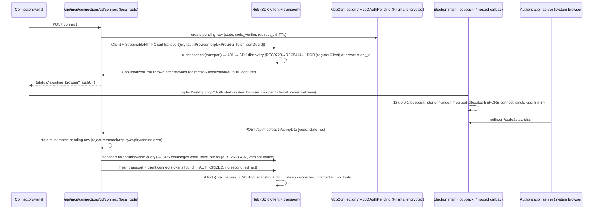

# MCP OAuth — Orplex connectors on the official MCP TypeScript SDK

Living document. Phase 1 records the SDK decision and the exact flow to implement;
later phases append data model, diagrams, and debug guides.

## 1. SDK decision (Phase 1)

| | |
|---|---|
| Package | **`@modelcontextprotocol/client`** (the split v2 packages, replaces the monolithic `@modelcontextprotocol/sdk` v1) |
| Version | **2.3.0** — pinned exact in `package.json` (no `^`) |
| License | **Apache-2.0** (per the package's `package.json`; note the v1 monolith `@modelcontextprotocol/sdk` was MIT) |
| Node engines | `>=20` (repo `engines` is `24.x`, Electron ships Node ≥22 — OK) |
| Why v2 | The package README states *"v2 is the stable release line, implementing the 2026-07-28 MCP spec … It replaces the monolithic `@modelcontextprotocol/sdk` package from v1."* The task spec mandates following the README's current recommendation. |
| Transitive deps | `@modelcontextprotocol/core@2.3.0`, `jose` (JWT/DPoP), `pkce-challenge`, `eventsource`, `cross-spawn`, and a **nested `zod@4`** (nested under the package — our top-level `zod@3.25.76` is untouched; no peer-dep conflict, `npm view … peerDependencies` is empty) |

Import paths (verified from the installed package, v1 names unchanged — only paths moved):

```ts
import { Client, StreamableHTTPClientTransport, SSEClientTransport,
         UnauthorizedError, type OAuthClientProvider, type OAuthClientMetadata,
         type FetchLike, auth, registerClient } from "@modelcontextprotocol/client";
import { StdioClientTransport, getDefaultEnvironment,
         type StdioServerParameters } from "@modelcontextprotocol/client/stdio";
```

## 2. Installed API — verified against `node_modules/@modelcontextprotocol/client@2.3.0/dist/*.d.mts`

All names below were read from the installed `.d.mts` files and the official v2 docs
(`ts.sdk.modelcontextprotocol.io/v2/clients/{connect,oauth,calling}.md`) — not from memory.

- `Client` (`index.d.mts:2165`) — `connect(transport)`, `listTools(params?, options?)`,
  `callTool({name, arguments})`, `ping`, `close()`.
  **`listTools()` walks all pages automatically** (follows `nextCursor`, `listMaxPages`
  default 64 → `LIST_PAGINATION_EXCEEDED` on runaway servers; explicit `{cursor}` fetches one raw page).
- `StreamableHTTPClientTransport(url, opts)` (`:3504`) / `SSEClientTransport` (`:3235`) —
  both accept **`authProvider?: AuthProvider | OAuthClientProvider`** and
  **`fetch?: FetchLike`** (`FetchLike = (url, init?) => Promise<Response>`, `:1666`).
  ✅ **Custom-fetch injection is supported** → we can pass an SSRF-guarded fetch that also
  covers discovery/registration/token requests made on the provider's behalf.
- `StdioClientTransport({command, args?, env?, stderr?, cwd?, maxBufferSize?})`
  (`stdio.d.mts:54`) — `maxBufferSize` defaults to **10 MB** (bounded buffer built in),
  `stderr: "pipe"` gives an early-bound `transport.stderr` stream + `pid`,
  `close()` tears down (stdin → SIGTERM → SIGKILL per docs).
  `getDefaultEnvironment()` / `DEFAULT_INHERITED_ENV_VARS` = the safe base env
  (spec: *declared env vars + safe base env* — use this instead of `process.env`).
- `finishAuth(callbackParams: URLSearchParams)` — exists on **both** HTTP transports
  (`:3598`, `:3280`), plus positional `finishAuth(code, iss?)`. Docs: pass the whole
  callback query (`URLSearchParams`) — it extracts `code`, validates RFC 9207 `iss`,
  exchanges at the AS resolved before the redirect, and `saveTokens()`s through the provider.
- `auth(provider, options)` (`:858`) — the flow orchestrator (`AuthResult = 'AUTHORIZED' | 'REDIRECT'`);
  transports call it internally. `registerClient(url, {...})` (`:1205`) = DCR (RFC 7591).
- `OAuthClientProvider` (`:430-666`) — storage/redirect surface:
  `redirectUrl`, `clientMetadata`, `state?()`, `clientInformation(ctx?)` / `saveClientInformation?(…, ctx?)`,
  `tokens(ctx?)` / `saveTokens(…, ctx?)`, **`redirectToAuthorization(url)`**,
  `saveCodeVerifier(v)` / `codeVerifier()`, `invalidateCredentials?(scope)`,
  `saveDiscoveryState?/discoveryState?`, `validateResourceURL?`, `dpop?`, `addClientAuthentication?`.
  Credentials keyed by `ctx.issuer` (SEP-2352) so a client_id from one AS never goes to another.
  `redirectToAuthorization` **just receives the URL** — exactly the "emit, don't open" contract the spec wants.
- `UnauthorizedError` (`:679`) — brand-based `hasInstance`; thrown by `connect()` when the
  server requires auth (after `redirectToAuthorization` already fired).
- Security rails the SDK gives us for free: HTTPS-only token endpoints (`assertSecureTokenEndpoint`,
  loopback exempt), RFC 8414 issuer-echo validation (`IssuerMismatchError`), RFC 9207 mix-up
  defense, DCR rejection errors (`RegistrationRejectedError`), 403 `insufficient_scope` step-up,
  optional DPoP. **We never reimplement discovery/DCR/PKCE/refresh** — spec rule satisfied.

## 3. The exact flow we will implement (remote OAuth connector)



Hosted/non-desktop: same flow except step "BR" — the AS redirects to
`/api/mcp/oauth/callback` on the UI origin (state is validated against the server-stored
pending row bound to the session user + serverId; cookies are not read at redirect time).

Desktop port variance: the loopback listener binds its random port **first**, and that exact
`redirect_uri` goes into `clientMetadata.redirect_uris` / DCR — no wildcard-port guessing.

## 4. Conflicts & decisions (spec ↔ code ↔ SDK)

Updated each phase. Full list grows per phase; see git history for additions.

| # | Conflict | Decision |
|---|---|---|
| C1 | Spec names v1-era packages; README recommends v2 split packages | Use `@modelcontextprotocol/client@2.3.0`; spec's API names (`finishAuth`, transports, provider interface, `UnauthorizedError`) all exist in v2 with the same names (verified above). |
| C2 | `src/proxy.ts` rewrites all `/api/*` to the cloud backend; `LOCAL_ONLY_API_ROUTES` is exact-match only, so dynamic routes like `/api/mcp/connections/[id]/connect` can never match | Add **prefix matching** (`/api/mcp/*`, `/api/agent/mcp/*`) to `proxy.ts` and move ALL MCP routes local (single connection store — no split-brain between cloud `McpServerConfig` rows and local `McpConnection` rows). Backend's duplicate `/api/mcp/*` handlers become dead for this deployment (mirror = follow-up). |
| C3 | Server-lane runs execute on the **backend** (instrumentation.ts:51 disables the local executor when `ORPLEX_API_URL` is set), whose DB won't have the new tables | Server-lane MCP works in local/offline mode (shared local DB); cloud executor runs don't see MCP connections until a backend mirror. Browser (interactive) lane works everywhere. Documented limitation, not silently promised. |
| C4 | `.env` has no `DIRECT_URL` (DATABASE_URL = local `localhost:5433`); a `directUrl = env("DIRECT_URL")` would hard-fail `prisma validate`/`generate`/runtime with P1012 whenever the var is unset — and `.env` edits are out of bounds | **No `directUrl` in the schema** (the earlier plan to add it was reverted after hitting P1012). Migrations run against `DATABASE_URL` (direct localhost here). The future hosted migration (backend mirror) adds `directUrl` in that environment *with* `DIRECT_URL` supplied inline at invocation. Migration folder: `prisma/migrations/20261004000000_add_mcp_oauth/`. There is no local `prisma` CLI in `package.json` — always pin it: `npx --yes prisma@5.20.0 …` (matches `@prisma/client@5.20`; a bare `npx prisma` resolves to v7, which rejects this schema's syntax entirely). |
| C5 | No `src/lib/agent/loop/`; two loops (`background-worker.ts:847`, `server-executor/executor.ts:864`) assemble tools in different places | ONE shared tool-array builder (`src/lib/mcp/tool-builder.ts`, Phase 5) feeds chat route tools, master-prompt section, executor defs, and the What-AI-sees endpoint. |
| C6 | MCP calls bypass risk/approval in both lanes today (`native-tools.ts:177` early-returns; executor gates only `run_command`) | Phase 4/5 route `mcp__*` through `classifyRisk` (MCP-aware: `readOnlyHint`→low, default medium) + both lanes' approval paths; per-server "auto-approve read-only" toggle. |
| C7 | Existing `checkUrlPolicy` allows `http://public` (no scheme check) | MCP wrapper = existing policy **+ `https:` required unless loopback**; injected as the transports' `fetch` (supported — verified) so discovery/registration/token requests are covered too. |
| C8 | Legacy renderer token storage (`localStorage orplex.mcp.remotes.v1`) violates "tokens never in the renderer" | All tokens move to `McpConnection.tokensCiphertext` (AES-256-GCM, same key as BYOK — see §5); legacy paths stay runnable behind `ORPLEX_MCP=legacy` until Phase 8 passes, then are dead code (removal noted in final report). **Shipped in Phase 8:** `resolveMcpLane` in `src/lib/mcp/gate.ts` — only the exact value `legacy` selects the old lane; default is `sdk`. |
| C9 | Proxy has **no CSRF layer** (delegated to backend by design) | Hosted callback protection = session-gated route + one-time server-stored `state` bound to user+serverId (single use, TTL, replay rejection) — the state IS the anti-CSRF token. |
| C10 | Prompt meter never meters tool schemas; executor silently `slice(0,20)`s MCP tools | Builder (Phase 5) never drops silently (>40 → names-only + `mcp_search_tools`/`mcp_describe_tool` meta tools); meter accounts MCP schema chars. |

## 5. Data model & persistence (Phase 2)

Migration: `prisma/migrations/20261004000000_add_mcp_oauth/migration.sql`
(apply with `npx --yes prisma@5.20.0 migrate dev` against a reachable DB — see C4 for the
CLI-pinning rule; the local DB at `localhost:5433` was down during development, so the
migration is generated via `prisma migrate diff --from-empty --to-schema-datamodel` and
committed unapplied).

### `mcp_connections` — one OAuth-authorized remote connector per (user, catalog id)

| Column | Notes |
|---|---|
| `transport`, `url` | `streamable-http` (default) or `sse` + endpoint |
| `status` | `connected` \| `needs_reauth` \| `disconnected` — set `needs_reauth` with **wiped** ciphertext when a refresh dies (`invalid_grant`) or the SDK calls `invalidateCredentials` |
| `issuer` | authorization-server issuer the tokens/client are bound to (SEP-2352); reads are issuer-checked |
| `clientId` / `clientSecret` | DCR result; id plaintext (not a secret), secret ciphertext |
| `tokensCiphertext` | AES-256-GCM JSON of `StoredOAuthTokens` — **the only place tokens exist**; decrypted in-process by `loadConnectionTokens` only |
| `tokenType`, `scope`, `expiresAt` | query/display metadata (Bearer/DPoP, granted scopes, expiry) |
| `version` | optimistic lock — every write is `UPDATE … WHERE id AND version` + bump, ≤3 retries against the fresh row, then typed `McpTokenConflictError` |

Stdio/token connectors are unchanged: they stay in `mcp_server_configs` (Claude Code wire
shape) — an entry may have BOTH rows (hybrid catalog entries); the UI prefers OAuth.

### `mcp_oauth_pendings` — one-time authorization state (the anti-CSRF token, C9)

| Column | Notes |
|---|---|
| `state` | 32-byte `base64url`, `@unique` — created **before** the browser round-trip (`createPending`) |
| `codeVerifier` | PKCE verifier written by the provider's `saveCodeVerifier` (server-side only) |
| `redirectUrl` | exact `redirect_uri` the loopback listener bound (port allocated first) |
| `authorizationUrl` | captured from `redirectToAuthorization` — returned to the UI once, then never auto-opened |
| `issuer`, `discoveryState` | SDK discovery results (SEP-2352) so the callback leg can bind without re-discovery |
| `status` / `consumedAt` | claim flips `pending → consumed` in ONE guarded `UPDATE` (state + not-expired + not-yet-consumed); replays get typed `used` / `expired` / `unknown` / `failed` |
| `version` | `failPending(id, expectedVersion, reason)` is version+`status:consumed` guarded — a stale writer gets `false`, not a silent overwrite |
| `expiresAt` | 10-minute TTL; `sweepExpiredPendings` drops rows a day past it |

### Module map (Phase 2, all under `src/lib/mcp/oauth/`)

- `store.ts` — token/credential persistence: per-`(userId,serverId)` in-process mutex
  (`withConnectionLock`), version-guarded writes, ciphertext round-trip, `markNeedsReauth`,
  `listConnections` (ciphertext columns stripped — safe for API responses).
- `pending.ts` — `createPending` / `claimPending` (single-use) / `failPending` (optimistic) /
  verifier+authorization+discovery setters / `sweepExpiredPendings`.
- `provider.ts` — `DbMcpOAuthProvider implements OAuthClientProvider`: DCR metadata with our
  exact loopback `redirect_uri`, issuer-checked client info, catalog `staticClientId`
  override, `allowDynamicRegistration: false` → **typed `McpStaticClientRequiredError`**
  (`code: mcp_static_client_required`) instead of a stack trace, `state()` returns the
  pending row's state, auth URL captured-not-opened, `invalidateCredentials("tokens"|"all")`
  → `needs_reauth`.
- Tests: `src/lib/__tests__/mcp-oauth.test.ts` (20 tests, mocked Prisma): single-use claim
  + typed reasons, version guard + retry + typed exhaustion, mutex serialization (and
  unwedging after a rejected section), ciphertext-at-rest round-trips, issuer mismatch
  rejection, typed no-DCR error.

## 6. Routes & desktop bridge (Phase 3)

### HTTP surface (all session-gated with `jwtOnlyOptions`, local-only per C2)

| Route | Job |
|---|---|
| `POST /api/mcp/connections/[serverId]/connect` | Validates `redirectUri` **before** any pending row/network call (exact hosted callback or RFC 8252 loopback only — see below), then `startAuthorization` → `{status:"awaiting_browser", authUrl, state, expiresAt}` \| `{status:"connected"}` (stored tokens already work) \| `{status:"error", code, error}` (`no_remote` 400, `mcp_static_client_required`/`network`/`oauth_failed` 502) |
| `POST /api/mcp/oauth/complete` | Desktop leg: renderer posts `{state, code?, iss?, error?, error_description?}` **with its session cookie** (the Electron main process has none). Single-use claim → session↔state binding → `finishAuth(whole query)` → verify connect. Codes: `state_unknown/expired/used/failed`, `wrong_owner`, `denied` → 400; `issuer_mismatch`, `exchange_failed`, `verify_failed`, `no_remote` → 502 |
| `GET /api/mcp/oauth/callback` | Hosted leg: the AS redirects the browser here with the session cookie; exchange runs server-side; answers with a small branded HTML page (`Cache-Control: no-store`) telling the user to return to the app |

Redirect policy (`flow.ts`): `resolveRedirectUri` accepts only (a) the exact
`<origin>/api/mcp/oauth/callback`, or (b) `http://127.0.0.1|localhost:<any-port>/callback`
with no credentials — https-loopback, private LAN IPs, external hosts, and other paths are
rejected with `bad_redirect` before anything is created.

### How `auth()` is driven (verified against the installed client)

`client.connect(transport)` → transport gets 401 → `adaptOAuthProvider.onUnauthorized` →
`auth(provider, …)` (discovery → DCR → PKCE → `redirectToAuthorization`) →
`auth() !== "AUTHORIZED"` throws **`UnauthorizedError`** (`index.cjs:265`) → the flow catches
it, reads the captured `provider.authorizationUrl`, and returns `awaiting_browser`.
No manual `auth()` call, no reimplemented discovery/DCR/PKCE.

### Electron loopback relay (`electron/mcp-bridge.ts`)

- `mcpOAuth.prepare()` → binds `127.0.0.1:0` (OS-assigned port) → returns the exact
  `redirectUri` for the connect body (port-first, per RFC 8252 / DCR exact-match).
- `mcpOAuth.open(authUrl)` → parses `state` out of the URL, stores it as the expected value,
  `shell.openExternal` (system browser, never a webview).
- AS redirect hits `/callback` → state checked (defense-in-depth; the server-side one-time
  claim is authoritative) → holding page → `orplex:mcp-oauth-callback` IPC to the renderer →
  single-use close (first hit settles it; 5-minute timeout otherwise).
- Renderer relays to `POST /api/mcp/oauth/complete` **because it holds the session cookie** —
  this is why the completion hop exists at all. `preload.ts` + `orplex-desktop.d.ts` expose
  `mcp.oauthPrepare / oauthOpen / onOAuthCallback`.

### Proxy (C2 implemented)

`LOCAL_ONLY_API_PREFIXES = ["/api/mcp/", "/api/agent/mcp/"]` + exact
`LOCAL_ONLY_API_ROUTES` in `src/proxy.ts` — all MCP traffic stays on this process; every
other `/api/agent/*` route still rewrites to the backend (covered by
`proxy-mcp-local.test.ts`).

### Tests (Phase 3): 30 new

`mcp-oauth-flow.test.ts` (redirect policy incl. 6 rejection cases; awaiting/connected/typed
start failures; state unknown/expired/replay; session binding; denial; exchange + issuer +
verify failures) and `proxy-mcp-local.test.ts` (prefix match + non-MCP control routes).

## 7. Hub, SSRF, risk (Phase 4)

### `hub.ts` — the SDK session manager (server-side only)

One live `Client` per (user, server) with shared wrapping rules:

| Rule | Value | Behavior |
|---|---|---|
| Status machine | `disconnected → connecting → connected` | plus `error` (backoff-gated) and `needs_reauth` (terminal until the user reconnects) |
| Single flight | — | concurrent callers share one `connect()` attempt |
| Connect/list/call timeouts | 15s / 15s / 30s | `McpHubTimeoutError` → close session, count a failure |
| Concurrency cap | 4 in-flight per server | FIFO waiters with their own timeout (→ `call_timeout`) |
| Tool-list cache | 60s TTL, ≤200 tools | `refresh:true` forces re-list |
| Backoff | 1s → 2s → … cap 60s | consecutive failures gate reconnects (`cooldown` error carries `retryAt`) |
| Idle close | 5 min | session self-closes when no calls are in flight |
| Protocol errors | — | invalid params / unknown tool rethrown **untouched**: session stays healthy, no failure counted |

`RuntimeMcpOAuthProvider` backs runtime connects: tokens/client-info from
Prisma (issuer-checked), silent refresh saves through the store, discovery
state in-memory — and every browser-redirect leg throws
`McpInteractiveAuthRequiredError`, which the hub maps to `needs_reauth` +
`markNeedsReauth`. Runtime NEVER does DCR (a runtime-registered client would
carry a placeholder `redirect_uri`); credential bootstrapping is exclusively
the connect route's job. Errors from `hubCallTool`/`hubListTools` are typed
`McpHubError` (`no_remote`, `unsupported_auth`, `needs_reauth`, `cooldown`,
`connect_failed`, `call_failed`, `call_timeout`).

### `ssrf-fetch.ts` (C7)

`checkMcpUrl`: http/https only · loopback (`localhost`/`127.x`/`[::1]`) allowed
on http **and** https · private/link-local/CGNAT/metadata hosts blocked ·
public hosts must be https. `ssrfFetch` is handed to the transports as their
`fetch` — covering MCP POSTs/SSE **and** the OAuth discovery/exchange requests
the SDK drives itself — in both `hub.ts` and `flow.ts`. Known limitation
(documented in-file): redirect hops aren't re-checked; safe because
transports default to same-origin redirects and catalog URLs are https-or-loopback.

### Risk tiering for MCP tools (C6)

`classifyRisk(tool, args, mcpHint)` grew an MCP branch (checked before the
unknown-tool fallthrough):

1. `destructiveHint` → **high** (elevated dialog, never rule-rememberable)
2. `readOnlyHint` + per-server auto-approve toggle → **low** (silent)
3. `readOnlyHint` alone → **medium** (one approval)
4. everything else → **medium**, "external side effects" (fail closed)

Hints: `risk-hint.ts` (browser-safe, localStorage) reads ToolAnnotations from
the registry cache + the `orplex.mcp.prefs.v1` per-server toggle
(`saveMcpServerPrefs` — the SDK lane's Prisma-backed lookup lands with
tool-builder in Phase 5). `native-tools.ts` calls `assessMcpToolRisk` **before**
`dispatchMcpToolCall`; rejections render `rejected by user` exactly like
`run_command`. Approval type `"mcp_tool"` was added to `ApprovalType` —
"always allow" keys on the full `mcp__<server>__<tool>` name
(`approvalKey`), and the store receives the precomputed tier via `riskHint`.

### Tests (Phase 4): 45 new

`mcp-ssrf-fetch.test.ts` (policy matrix + guard), `mcp-hub.test.ts` (status
machine, single-flight, transport fetch, needs_reauth, backoff/cooldown,
cache, caps, timeouts, protocol-error tolerance, idle close under fake
timers, runtime provider), `mcp-risk-hint.test.ts` (annotations + prefs +
wiring), plus the MCP block in `risk-classifier.test.ts`.

## 8. Sections added in later phases

### Phase 5 — discovery + visibility pipeline (C5 / C10 / C6)

**Persistence.** `McpTool` (Prisma, `mcp_tools`) holds one row per
discovered tool — unique on `(userId, serverId, name)`, with the full
`inputSchema` JSON and ToolAnnotations (`annotations`) so the server lane can
risk-tier without the localStorage registry (C6). Migration
`20261004000001_add_mcp_tools` also adds
`mcp_connections.autoApproveReadOnly` — the SDK-lane Prisma twin of the
browser lane's `orplex.mcp.prefs.v1` toggle — and the `connected_no_tools`
status value. Both migrations are committed unapplied (local PG down).

**Snapshot (`tool-snapshot.ts`, server-only).** The hub writes after every
successful `tools/list` — fire-and-forget so a slow table never delays the
call — persisting the FULL list (pre-`HUB_MAX_TOOLS`). `diffTools` is pure:
added / removed / changed (fingerprint = description+schema+annotations) /
unchanged, plus the status the result implies. Status flips
`connected ↔ connected_no_tools` ONLY from a connected-ish starting point —
`needs_reauth` / `disconnected` belong to the OAuth/connect state machines
and are never clobbered. Rows are capped at `SNAPSHOT_MAX_TOOLS = 500`;
`clearToolSnapshot` runs on disconnect.

**Builder (`tool-builder.ts`, pure — C5's one shared tool-array builder).**
`buildMcpRoster(tools, { serverMeta })` → model defs + the
`## MCP CONNECTOR TOOLS` prompt section + server summaries + `schemaChars`.
Cap policy (C10): over `MCP_TOOL_CAP = 40` tools → **names-only** defs for
EVERY tool (`additionalProperties: true`, no silent `slice()`) plus the
`mcp_search_tools` / `mcp_describe_tool` meta tools; `executeMcpMetaTool`
answers both against the same list the roster was built from (search matches
names/descriptions/servers; describe returns the full JSON schema).

**Consumers.** Chat route: snapshot roster → `buildSystemPrompt({ mcpSection })`
+ the tools array (compact-tools providers — Groq TPM — skip MCP schemas;
the roster still rides in the prompt section). Master-prompt's
`buildMcpToolsSection` now delegates to the builder (registry lane, same
format as before). Executor: `buildNativeToolDefs` and its prompt roster both
go through the builder (the old silent `slice(0, 20)` is gone), with meta-tool
dispatch in `executeTool`. The renderer lane's `native-tools` dispatches the
meta tools against the localStorage roster. Metering (C10): the worker passes
`toolSchemaChars` (builder-computed) into `recordPromptCall`; those chars are
counted into `systemTokens` and surfaced as `toolSchemaTokens` per call.

### Phase 6 — catalog audit → `docs/MCP-CATALOG-AUDIT.md`

`npm run audit:mcp` (`scripts/audit-mcp-catalog.mjs`) is the phase the
catalog header promises ("probes each candidate and only verified endpoints
ship as `remote`"). It compiles `mcp-catalog.ts` + `ssrf-fetch.ts` with the
repo's own tsc into `node_modules/.cache/orplex-mcp-audit` (no dependency on
the TS toolchain beyond what's installed, no regex-scraping), then runs two
halves:

- **Static (always; `--offline` skips probes)** — re-runs the Zod
  validation, then the checks the schema can't express: https-or-loopback on
  every remote candidate via the real `checkMcpUrl` (zero policy drift),
  shell metacharacters in stdio command/args (placeholder args like
  `--project-ref=<x>` exempt — spawn runs without a shell), auth-hint
  invariants (same rules as `mcp-catalog.test.ts`), docsUrl https, duplicate
  ids/names, category coverage, OAuth-by-default observations.
- **Probes** — MCP `initialize` POST per remote candidate (verdicts
  `verified` / `auth-gated` / `not-mcp` / `unreachable`; 3 attempts with
  backoff for transient DNS/reset and `Accept: */*` retry for 405/406/415),
  npm/PyPI existence per stdio package (ok / deprecated / missing / dead =
  metadata shell with no installable version; `pkg@version` specs stripped
  before lookup), docsUrl GETs. `remote.spec` failures are **hard** failures
  — only verified endpoints ship as `remote`; mcp-remote stdio-arg failures
  warn (the Connectors panel's live `listTools` probe is the backstop).
  `--strict` promotes warnings to failures. Exit: 0 pass, 1 over threshold,
  2 setup failure.

**First-run findings (2026-10-04) — fixed in this phase:**

- All 15 proxy entries ran `npx @anthropic-ai/mcp-remote` — that package
  does not exist (npm E404) → `mcp-remote` (the bridge Elastic's own docs
  recommend; `0.14.3`).
- Gmail pointed at NXDOMAIN `gmail.mcp.google.com/mcp` → Google's official
  `https://gmailmcp.googleapis.com/mcp/v1` (probe: **verified**, 200
  jsonrpc).
- ElevenLabs pointed at NXDOMAIN `mcp.elevenlabs.io/mcp` → official hosted
  `https://api.elevenlabs.io/v1/mcp` (probe: **auth-gated**, OAuth).
- Cloudflare pointed at record-less `bindings.cloudflare.com/mcp` →
  `https://mcp.cloudflare.com/mcp` (probe: **auth-gated**, RFC9728 metadata
  + scopes).
- Railway pointed at `railway.app/mcp`, which serves an HTML page
  ("Only HTML requests are supported here") → `https://mcp.railway.app/mcp`
  (probe: **auth-gated**, `realm="mcp"` + resource metadata).
- OneDrive pointed at record-less `mcp.microsoft365.com/mcp` →
  `https://graph.microsoft.com/mcp/v1` (probe: **auth-gated** with AAD
  `authorization_uri`; the whole `/mcp/v1` tree auth-gates before routing —
  client restrictions can't be proven until a real connect, so the panel's
  `listTools` probe remains the backstop).
- `netlify-mcp` → `@netlify/mcp`, `apify-mcp-server` →
  `@apify/actors-mcp-server` (official vendor packages, registry-verified).

**Open findings (in the report; decisions deferred to Phase 7):**

- `mcp.elastic.co` is NXDOMAIN — Elastic ships no public endpoint; its
  servers proxy *your* cluster (`@elastic/mcp-server-elasticsearch` + env,
  or `https://www.elastic.co/docs/_mcp/` for docs only — probe-verified).
- Azure: `mcp.azure.com/mcp` is an HTML docs page (POST → 405,
  `ai.azure.com/mcp` → 405), and `@azure/azure-mcp` doesn't exist on npm —
  no npx-able or probe-verified endpoint found.
- Dead stdio packages: `prisma-mcp`, `@QuantGeekDev/docker-mcp`,
  `mcp-grafana`, `framer-mcp`, `asana-mcp-server`, `perplexity-ask`,
  `razorpay-mcp-server`, `mcp-anthropic`; unpublished shells: `render-mcp`,
  `fly-mcp`, `penpot-mcp`. Probe-verified hosted alternatives exist for
  Asana (`https://mcp.asana.com/sse`) and Perplexity
  (`https://api.perplexity.ai/mcp`) — both auth-gated; registry candidates:
  `razorpay-mcp`, `docker-mcp-server`, `mcp-grafana-npx`.
- Deprecated-but-installable: `@modelcontextprotocol/server-{github,
  puppeteer,brave-search,gdrive,google-maps,postgres}`, `sonarqube-mcp-server`,
  `@circleci/mcp-server-circleci`, `@browserbasehq/mcp-server-browserbase`,
  `@neondatabase/mcp-server-neon` (npm deprecation text names successors).
- Wikipedia has no official hosted MCP (third-party candidates only).
- 14 mcp-remote entries still carry `auth=none` — OAuth runs inside
  mcp-remote; the hint rework belongs to Phase 7's UI.

### Phase 7 - Connectors panel: statuses, C6 toggle, browser sign-in

Server-side read model + routes behind the panel (tokens never leave
`store.ts`):

- `src/lib/mcp/connection-view.ts` - `listConnectionViews(userId)` joins
  `SafeConnection` rows with catalog metadata and the Phase 5 tool snapshot
  (`mcpTool.groupBy`) into `{name, description, auth, toolCount, ...}`.
- `GET /api/mcp/connections` - that view for the session user;
  `PATCH /api/mcp/connections/[serverId]` - `{autoApproveReadOnly}` (the C6
  toggle, Prisma column, no version bump - it cannot race token writes);
  `DELETE /api/mcp/connections/[serverId]` - `disconnectConnection` wipes
  ciphertext + client registration in place while the row and its preference
  survive for the next connect.
- `ConnectorsPanel.tsx` renders an "OAuth connectors" section: status badges
  (`connected` / `connected_no_tools` / `needs_reauth` / `disconnected`, with
  `failureReason` on reauth), per-connector "Auto-approve reads" checkbox,
  Re-authorize / Reconnect, and disconnect. Catalog detail for `auth=oauth`
  remotes gained the SDK sign-in flow: `oauthPrepare` (main binds the
  loopback before connect) -> `POST /connections/[id]/connect` ->
  `oauthOpen(authUrl)` -> `onOAuthCallback` relays to
  `POST /api/mcp/oauth/complete`; a 60 s poll covers the hosted-callback
  path (plain browser tab, no Electron bridge). The stdio env form and
  "Save changes" are hidden for OAuth remotes (there is no token/stdio path
  to save - `mcp-accounts.ts` rejects those).

**Bug found & fixed while wiring this up:** `store.ts` wrote
`failureReason` into `mcp_connections` updates (token save, `markNeedsReauth`,
client registration) but the Phase 2 migration only created the column on
`mcp_oauth_pendings` - Prisma rejects the unknown argument at runtime. It
went undetected because every test mocks Prisma. Migration
`20261004000002_add_mcp_connection_failure_reason` adds the column;
`McpConnectionStatus` now includes `connected_no_tools` (the Phase 5 value).

**Tests (Phase 7): +8** - `mcp-connection-view.test.ts` (3: catalog join +
counts, unknown-id fallback, empty list) and `mcp-oauth.test.ts` (+5: toggle
column update/missing row, disconnect wipe/preference survival, listConnections
surfaces toggle + reason without ciphertext). Full suite: 1132 passing.

### Phase 8 - ORPLEX_MCP gate; both lanes dispatch through the hub (C8/C6)

One gate decides where `mcp__<server>__<tool>` executes:

- `src/lib/mcp/gate.ts` - `resolveMcpLane(raw)`: only the exact string
  `legacy` (trim/case-insensitive) returns `"legacy"`; unset, empty, or any
  typo returns `"sdk"` (the DEFAULT), so a bad env value can never silently
  fall back to the renderer token store.
- HTTP surface (session-gated `jwtOnlyOptions`, prefix already local via C2):
  - `GET /api/agent/mcp` - `{lane}` for the renderer (server env is not
    readable there; fetched once per session).
  - `GET /api/agent/mcp/tools` - Phase 5 snapshot roster for one user plus
    `serverPrefs: {serverId: {autoApproveReadOnly}}` from Prisma - read-only;
    no ciphertext, no tokens.
  - `POST /api/agent/mcp/call` - `{serverId, tool, args}` -> `hubCallTool`
    (server-side OAuth tokens in `McpConnection`); hub errors map honestly:
    `needs_reauth` -> 401, `cooldown` -> 503 + `retryAt`, other hub failures
    -> 502, unexpected -> 500. Success returns `{text, isError}` only.

Renderer lane (`native-tools.ts`): `getMcpLane()` caches the lane promise
(fetch failure -> `"sdk"`); the `mcp__` branch forks risk assessment
(legacy = localStorage `assessMcpToolRisk`, sdk = `assessSdkMcpRisk`:
snapshot annotations + Prisma toggle -> `mcpRiskHintFrom` ->
`classifyRisk`, roster fetched with a 60 s cache) and dispatch
(`dispatchMcpToolCall` vs the new `dispatchMcpToolCallSdk`, which POSTs
`/api/agent/mcp/call` and keeps the exact `{resultXml, blocked}` contract:
reconnect hint on `needs_reauth`, retry window on `cooldown`, 30 000-char
clip, invalid-name path without an API call). The meta tools
(`mcp_search_tools`/`mcp_describe_tool`) read the same roster the lane
discovered from - localStorage registry or snapshot.

Executor lane (`executor.ts`): `resolveMcpLane` is read from env directly
(same process). In the sdk lane the run fetches `listSnapshotToolsByServer`
once, minus names that collide with workspace/account stdio configs (stdio
wins), and merges `remoteTools` through the shared Phase 5 builder into
defs + prompt (plus catalog summaries alongside the stdio ones).
`executeTool` gained `mcpExtras {userId, remoteTools}`: the `mcp__` branch
now runs the DB-backed C6 gate FIRST (`assessMcpToolRiskDb` -> the existing
`requestUserApproval`, which parks the run) and only then dispatches -
stdio config path unchanged, sdk path `hubCallTool` with an honest
`needs_reauth` hint, and the original "no MCP server" error only when
neither lane has the server. Meta tools merge `remoteTools` into the
search/describe roster.

Known limitation (documented, not silently patched): the chat route's
prompt roster comes from the snapshot server-side and was left unchanged;
under `ORPLEX_MCP=legacy` the *dispatch* works through localStorage but the
prompt roster only shows tools once the hub has populated the snapshot.
The default sdk lane is consistent end-to-end.

**Tests (Phase 8): +21** - `mcp-gate.test.ts` (2: fail-safe defaults,
exact-legacy), `mcp-risk-db.test.ts` (6: toggle+annotation matrix, fail-closed
on read errors, non-MCP fallback), `mcp-dispatch-sdk.test.ts` (7: invalid
name, POST contract, tool errors, reauth/cooldown mapping, truncation,
fetch failure), risk-classifier +4 (`mcpRiskHintFrom` mapping + end-to-end),
native-tool-defs +2 (remoteTools merge, over-cap names-only + meta tools).

### Phase 9 - how to add a connector; debugging login failures / missing tools

**Adding a connector (user-facing):**

- *OAuth remote (default lane):* Settings → Connectors → pick a catalog
  remote → "Sign in with OAuth" runs `oauthPrepare` (Electron binds the
  loopback first) → `POST /connections/[id]/connect` → browser →
  `oauthOpen(authUrl)` → callback relays to `POST /api/mcp/oauth/complete`
  (hosted setups instead ride the 60 s poll on the same complete POST).
  Success now ALSO fires hub discovery (`refreshServerSnapshot`) so tools
  appear immediately.
- *stdio/custom server:* save it in the Connectors form (env/command path,
  `mcp-accounts`), then "Test connection" — the probe's real tools/list is
  persisted as the roster (Phase 9 trigger in `test-connection`).
- Tools then flow to: prompt sections + defs (chat route & executor, C5
  builder), `GET /api/agent/mcp/tools` (renderer loop, sdk lane), the
  `toolCount` badges (`connection-view`), and the What-AI-sees page.

**Debugging login failures:**

- Panel shows `needs_reauth` with `failureReason` (set by `markNeedsReauth`
  on revoked/invalidated credentials, or pending-stage failures like
  "authorization denied"). Re-authorize = full sign-in again; Reconnect is
  the pre-auth re-entry.
- 4xx from the AS at complete time maps to typed codes: `denied`,
  `state_unknown/expired/used/failed` (replay-safe one-time state),
  `wrong_owner`, `issuer_mismatch` (RFC 9207), `exchange_failed`,
  `verify_failed` (token exchanged but the MCP endpoint rejects the
  session). Statuses are in the complete route's `statusFor`.
- `redirect_uri` must be the bound loopback or the hosted callback origin
  (policy in flow.ts); plain `http://` endpoints are rejected outside
  loopback (C7 SSRF fetch) — the classic "transport error" on connect is
  usually this.
- If requests seem to hit the cloud instead of local state, verify the
  proxy keeps `/api/mcp/*` and `/api/agent/mcp/*` local (C2 prefix match in
  `src/proxy.ts`) — split stores look exactly like "my connection vanished".

**Debugging missing tools:**

- Roster source of truth = the `mcpTool` snapshot (`syncToolSnapshot`).
  Phase 9 wired the two triggers (both OAuth complete routes — desktop
  POST `/complete` and hosted `GET /callback` — plus test-connection) and
  self-heal: `GET /api/agent/mcp/tools` awaits discovery for every
  `connected` server that has no snapshot rows (`refreshMissingSnapshots`,
  parallel, errors swallowed). Empty prompt section → check that server's
  connection status first; `connected_no_tools` means discovery ran and the
  server really advertised none.
- Over 40 tools → names-only defs + `mcp_search_tools`/`mcp_describe_tool`
  is intentional (C10), not a bug; the prompt meter accounts the schemas.
- Name conflicts: workspace/account stdio configs win over snapshot tools
  with the same server id (Phase 8 filter) — one def, the stdio one.
- Lane mismatches: `ORPLEX_MCP=legacy` keeps the old localStorage dispatch
  but NOT prompt assembly (chat/executor read the snapshot); the default
  `sdk` lane is consistent end-to-end. An unset/typo'd `ORPLEX_MCP` always
  means `sdk` (fail-safe, C8).
- Model sees `mcp__<server>__<tool>` but the call errors "no MCP server" →
  the tool came from a stale prompt: the executor only dispatches servers
  present in the snapshot (sdk lane) or its stdio configs; refresh the
  roster (self-heal on next roster fetch) and resubmit.

**Tests (Phase 9): +5** - `mcp-roster-refresh.test.ts` (4: discover+persist,
skip current/non-connected rows, per-server errors swallowed, dead db no-op)
and `mcp-oauth-flow.test.ts` updated (complete now returns `serverId`).
