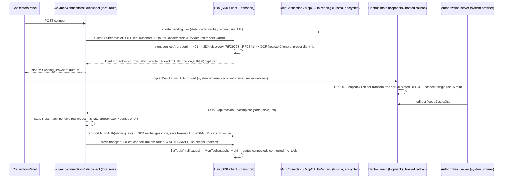

# MCP OAuth — Orplex connectors on the official MCP TypeScript SDK

Living document. Phase 1 records the SDK decision and the exact flow to implement;
later phases append data model, diagrams, and debug guides.

## 1. SDK decision (Phase 1)

| | |
|---|---|
| Package | **`@modelcontextprotocol/client`** (the split v2 packages, replaces the monolithic `@modelcontextprotocol/sdk` v1) |
| Version | **2.3.0** — pinned exact in `package.json` (no `^`) |
| License | **Apache-2.0** (per the package's `package.json`; note the v1 monolith `@modelcontextprotocol/sdk` was MIT) |
| Node engines | `>=20` (repo `engines` is `24.x`, Electron ships Node ≥22 — OK) |
| Why v2 | The package README states *"v2 is the stable release line, implementing the 2026-07-28 MCP spec … It replaces the monolithic `@modelcontextprotocol/sdk` package from v1."* The task spec mandates following the README's current recommendation. |
| Transitive deps | `@modelcontextprotocol/core@2.3.0`, `jose` (JWT/DPoP), `pkce-challenge`, `eventsource`, `cross-spawn`, and a **nested `zod@4`** (nested under the package — our top-level `zod@3.25.76` is untouched; no peer-dep conflict, `npm view … peerDependencies` is empty) |

Import paths (verified from the installed package, v1 names unchanged — only paths moved):

```ts
import { Client, StreamableHTTPClientTransport, SSEClientTransport,
         UnauthorizedError, type OAuthClientProvider, type OAuthClientMetadata,
         type FetchLike, auth, registerClient } from "@modelcontextprotocol/client";
import { StdioClientTransport, getDefaultEnvironment,
         type StdioServerParameters } from "@modelcontextprotocol/client/stdio";
```

## 2. Installed API — verified against `node_modules/@modelcontextprotocol/client@2.3.0/dist/*.d.mts`

All names below were read from the installed `.d.mts` files and the official v2 docs
(`ts.sdk.modelcontextprotocol.io/v2/clients/{connect,oauth,calling}.md`) — not from memory.

- `Client` (`index.d.mts:2165`) — `connect(transport)`, `listTools(params?, options?)`,
  `callTool({name, arguments})`, `ping`, `close()`.
  **`listTools()` walks all pages automatically** (follows `nextCursor`, `listMaxPages`
  default 64 → `LIST_PAGINATION_EXCEEDED` on runaway servers; explicit `{cursor}` fetches one raw page).
- `StreamableHTTPClientTransport(url, opts)` (`:3504`) / `SSEClientTransport` (`:3235`) —
  both accept **`authProvider?: AuthProvider | OAuthClientProvider`** and
  **`fetch?: FetchLike`** (`FetchLike = (url, init?) => Promise<Response>`, `:1666`).
  ✅ **Custom-fetch injection is supported** → we can pass an SSRF-guarded fetch that also
  covers discovery/registration/token requests made on the provider's behalf.
- `StdioClientTransport({command, args?, env?, stderr?, cwd?, maxBufferSize?})`
  (`stdio.d.mts:54`) — `maxBufferSize` defaults to **10 MB** (bounded buffer built in),
  `stderr: "pipe"` gives an early-bound `transport.stderr` stream + `pid`,
  `close()` tears down (stdin → SIGTERM → SIGKILL per docs).
  `getDefaultEnvironment()` / `DEFAULT_INHERITED_ENV_VARS` = the safe base env
  (spec: *declared env vars + safe base env* — use this instead of `process.env`).
- `finishAuth(callbackParams: URLSearchParams)` — exists on **both** HTTP transports
  (`:3598`, `:3280`), plus positional `finishAuth(code, iss?)`. Docs: pass the whole
  callback query (`URLSearchParams`) — it extracts `code`, validates RFC 9207 `iss`,
  exchanges at the AS resolved before the redirect, and `saveTokens()`s through the provider.
- `auth(provider, options)` (`:858`) — the flow orchestrator (`AuthResult = 'AUTHORIZED' | 'REDIRECT'`);
  transports call it internally. `registerClient(url, {...})` (`:1205`) = DCR (RFC 7591).
- `OAuthClientProvider` (`:430-666`) — storage/redirect surface:
  `redirectUrl`, `clientMetadata`, `state?()`, `clientInformation(ctx?)` / `saveClientInformation?(…, ctx?)`,
  `tokens(ctx?)` / `saveTokens(…, ctx?)`, **`redirectToAuthorization(url)`**,
  `saveCodeVerifier(v)` / `codeVerifier()`, `invalidateCredentials?(scope)`,
  `saveDiscoveryState?/discoveryState?`, `validateResourceURL?`, `dpop?`, `addClientAuthentication?`.
  Credentials keyed by `ctx.issuer` (SEP-2352) so a client_id from one AS never goes to another.
  `redirectToAuthorization` **just receives the URL** — exactly the "emit, don't open" contract the spec wants.
- `UnauthorizedError` (`:679`) — brand-based `hasInstance`; thrown by `connect()` when the
  server requires auth (after `redirectToAuthorization` already fired).
- Security rails the SDK gives us for free: HTTPS-only token endpoints (`assertSecureTokenEndpoint`,
  loopback exempt), RFC 8414 issuer-echo validation (`IssuerMismatchError`), RFC 9207 mix-up
  defense, DCR rejection errors (`RegistrationRejectedError`), 403 `insufficient_scope` step-up,
  optional DPoP. **We never reimplement discovery/DCR/PKCE/refresh** — spec rule satisfied.

## 3. The exact flow we will implement (remote OAuth connector)



Hosted/non-desktop: same flow except step "BR" — the AS redirects to
`/api/mcp/oauth/callback` on the UI origin (state is validated against the server-stored
pending row bound to the session user + serverId; cookies are not read at redirect time).

Desktop port variance: the loopback listener binds its random port **first**, and that exact
`redirect_uri` goes into `clientMetadata.redirect_uris` / DCR — no wildcard-port guessing.

## 4. Conflicts & decisions (spec ↔ code ↔ SDK)

Updated each phase. Full list grows per phase; see git history for additions.

| # | Conflict | Decision |
|---|---|---|
| C1 | Spec names v1-era packages; README recommends v2 split packages | Use `@modelcontextprotocol/client@2.3.0`; spec's API names (`finishAuth`, transports, provider interface, `UnauthorizedError`) all exist in v2 with the same names (verified above). |
| C2 | `src/proxy.ts` rewrites all `/api/*` to the cloud backend; `LOCAL_ONLY_API_ROUTES` is exact-match only, so dynamic routes like `/api/mcp/connections/[id]/connect` can never match | Add **prefix matching** (`/api/mcp/*`, `/api/agent/mcp/*`) to `proxy.ts` and move ALL MCP routes local (single connection store — no split-brain between cloud `McpServerConfig` rows and local `McpConnection` rows). Backend's duplicate `/api/mcp/*` handlers become dead for this deployment (mirror = follow-up). |
| C3 | Server-lane runs execute on the **backend** (instrumentation.ts:51 disables the local executor when `ORPLEX_API_URL` is set), whose DB won't have the new tables | Server-lane MCP works in local/offline mode (shared local DB); cloud executor runs don't see MCP connections until a backend mirror. Browser (interactive) lane works everywhere. Documented limitation, not silently promised. |
| C4 | `.env` has no `DIRECT_URL` (DATABASE_URL = local `localhost:5433`) | Schema gains `directUrl = env("DIRECT_URL")`; migrations run with `DIRECT_URL` supplied at invocation (`.env.example` documents it; we do not edit `.env`). Runtime stays on `DATABASE_URL` (pooled URL when hosted = Supabase). No session advisory locks anywhere — pooler-safe by construction. |
| C5 | No `src/lib/agent/loop/`; two loops (`background-worker.ts:847`, `server-executor/executor.ts:864`) assemble tools in different places | ONE shared tool-array builder (`src/lib/mcp/tool-builder.ts`, Phase 5) feeds chat route tools, master-prompt section, executor defs, and the What-AI-sees endpoint. |
| C6 | MCP calls bypass risk/approval in both lanes today (`native-tools.ts:177` early-returns; executor gates only `run_command`) | Phase 4/5 route `mcp__*` through `classifyRisk` (MCP-aware: `readOnlyHint`→low, default medium) + both lanes' approval paths; per-server "auto-approve read-only" toggle. |
| C7 | Existing `checkUrlPolicy` allows `http://public` (no scheme check) | MCP wrapper = existing policy **+ `https:` required unless loopback**; injected as the transports' `fetch` (supported — verified) so discovery/registration/token requests are covered too. |
| C8 | Legacy renderer token storage (`localStorage orplex.mcp.remotes.v1`) violates "tokens never in the renderer" | All tokens move to `McpConnection.encryptedCredentials` (AES-256-GCM); legacy paths stay runnable behind `ORPLEX_MCP=legacy` until Phase 8 passes, then are dead code (removal noted in final report). |
| C9 | Proxy has **no CSRF layer** (delegated to backend by design) | Hosted callback protection = session-gated route + one-time server-stored `state` bound to user+serverId (single use, TTL, replay rejection) — the state IS the anti-CSRF token. |
| C10 | Prompt meter never meters tool schemas; executor silently `slice(0,20)`s MCP tools | Builder (Phase 5) never drops silently (>40 → names-only + `mcp_search_tools`/`mcp_describe_tool` meta tools); meter accounts MCP schema chars. |

## 5. Sections added in later phases

- Phase 2+: data model (`McpConnection`, `McpOAuthPending`, `McpTool`), migration notes.
- Phase 4: hub status machine, wrapping rules (timeouts/caps/backoff), SSRF details.
- Phase 5: discovery + visibility pipeline.
- Phase 6: catalog audit results → `docs/MCP-CATALOG-AUDIT.md`.
- Phase 9: how to add a connector; debugging login failures / missing tools.
